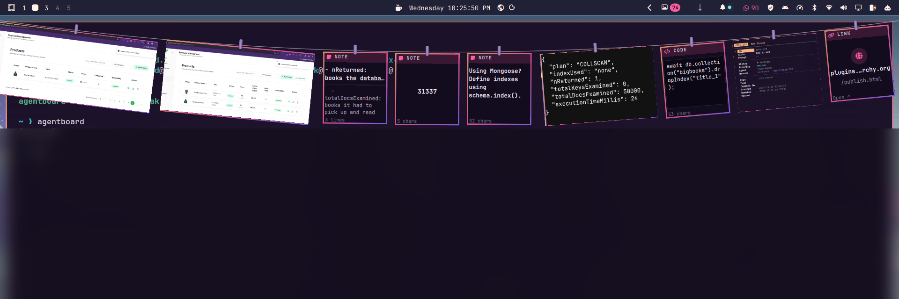

# Clothesline

[](https://github.com/tcballard/omarchy-badges)

Screenshots, recordings and what you copy hang on a line that drops from the bar. Click to copy.



## Features

- **Captures** — every screenshot and screen recording Omarchy makes hangs on
  the line, newest first.
- **Clipboard** — what you copy hangs there too, read from Omarchy's own
  clipboard history: text as a note (its first line the title), code as a code
  card, a lone web address as a link, copied images like any screenshot.
- **Drops from the bar** — rest the pointer just under the middle of the bar and
  the line drops down; move away and it tucks back up. Clicking the bar widget
  holds it down until you click elsewhere.
- **Scroll** the line to move along it.

| Action | What it does |
| --- | --- |
| Click | Copy the item to the clipboard |
| Double-click | Open it (image/video viewer, browser for links, editor for notes) |
| Right-click | Annotate (screenshots) / Reveal in files / Delete |
| × | Take it off the line (the file is kept) |

Copies a password manager marks as secret never reach the clipboard history, so
they never hang.

## Requirements

- Omarchy 4 with Quattro shell-plugin support.
- `wl-clipboard` (copying an item) and `gio` (trashing an item) — both ship
  with Omarchy by default.
- `omasnap` for the Annotate action on screenshots (ships by default).

No other dependencies; nothing is downloaded or built.

## Installation

### 1. Add the plugin

```bash
omarchy plugin add https://github.com/ayandexyz/clothesline.git --enable
```

Or from a local checkout:

```bash
omarchy plugin add "$(pwd)" --enable
```

This enables both parts: the background service (watches captures and the
clipboard history) and the bar widget (placed in the right section — move it
in the bar settings if you like).

### 2. Optional: put it on <kbd>Super</kbd> + <kbd>Ctrl</kbd> + <kbd>V</kbd>

Plugins can't bind keys, so the plugin never touches your keybindings. To have
<kbd>Super</kbd> + <kbd>Ctrl</kbd> + <kbd>V</kbd> drop the line instead of
opening Omarchy's clipboard panel, add this to `~/.config/hypr/bindings.lua`:

```lua
-- Clothesline takes over the clipboard manager key.
o.rebind("SUPER + CTRL + V", "Clothesline",
  "omarchy-shell shell toggle io.github.ayandexyz.clothesline '{}'")
```

Run `hyprctl reload` if the key doesn't take effect right away. Omarchy's clipboard plugin keeps
recording history in the background either way; only its panel loses the key.
To bind a different key instead, use `o.bind("SUPER + SHIFT + V", ...)` with
the same command.

## Update

```bash
omarchy plugin update io.github.ayandexyz.clothesline
```

## Removal

```bash
omarchy plugin remove io.github.ayandexyz.clothesline
```

If you added the keybinding, delete those lines from
`~/.config/hypr/bindings.lua` so <kbd>Super</kbd> + <kbd>Ctrl</kbd> + <kbd>V</kbd>
opens Omarchy's clipboard panel again. To also drop the plugin's own state:

```bash
rm -rf "${XDG_DATA_HOME:-$HOME/.local/share}/clothesline"
```

## What it reads and writes

The plugin watches `$XDG_PICTURES_DIR/Screenshots` (or `$OMASNAP_SCREENSHOT_DIR`
/ `$OMARCHY_SCREENSHOT_DIR`) and `$XDG_VIDEOS_DIR` (or
`$OMARCHY_SCREENRECORD_DIR`) — the same directories Omarchy's own capture
commands write to — and lists their contents. It does not move, copy, or
modify those files; Delete moves one to the trash, only when you choose it.

It reads `$XDG_STATE_HOME/omarchy/clipboard-history.json`, and only writes to
it when you choose Delete from history.

Its only state of its own is in `$XDG_DATA_HOME/clothesline/`:
`dismissed.json` lists what was taken off the line, so dismissing an item
doesn't bring it right back on the next scan, and `clipboard-seen.json` records
when each copy was first seen, so copies sit among the captures in the order
they came.

No network access. No privileged commands.

## Development

```bash
./tests/run
omarchy plugin validate .
```

## Security

Omarchy plugins run as unsandboxed code inside `omarchy-shell`. Review this
repository before enabling it.

## License

MIT © 2026 Ayan De — see [LICENSE](LICENSE).
